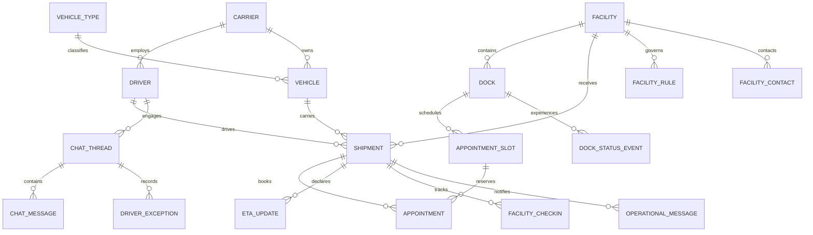

# SetuHaul Logistics — Domain Model & System Invariants

**Document Status:** Engineering Specification  
**Scope:** SetuHaul Relational Entities, Domain Services, Invariants, and Error Taxonomy  
**Target Database:** `setuhaul_freight_operations.db` (SQLite 3.x)

---

## 1. Domain Entity Breakdown

### 1.1 Fleet & Infrastructure
- **Carrier (`carriers`):** Fleet operating entities. Attributes: `carrier_id`, `carrier_name`, `contact_email`, `contact_phone`, `active_flag`.
- **Driver (`drivers`):** Verified commercial drivers. Attributes: `driver_id`, `carrier_id`, `driver_name`, `phone`, `licence_number`, `driver_status`.
- **Vehicle Type (`vehicle_types`):** Vehicle capability profiles. Attributes: `vehicle_type_code` (20FT, 32FT_SXL, 32FT_MXL, REEFER_32, HEAVY_40), `typical_dock_type`, `default_capacity_kg`, `refrigerated_flag`.
- **Vehicle (`vehicles`):** Physical assets. Attributes: `vehicle_id`, `registration_number`, `capacity_kg`, `refrigeration_capable`, `active_flag`.
- **Facility (`facilities`):** Distribution hubs. Attributes: `facility_id`, `facility_name`, `timezone` (`Asia/Kolkata`), `open_time`, `close_time`, `checkin_grace_min`, `default_unload_min`.
- **Dock (`docks`):** Physical bays. Attributes: `dock_id`, `dock_code`, `dock_type` (`STANDARD`, `REEFER`, `HEAVY`), `supports_refrigerated`, `max_vehicle_weight_kg`, `dock_status`.

### 1.2 Operations & Scheduling
- **Shipment (`shipments`):** Freight orders. Attributes: `shipment_id`, `order_reference`, `load_weight_kg`, `required_dock_type`, `temperature_control_required`, `priority_code` (`LOW`, `NORMAL`, `HIGH`, `CRITICAL`), `expected_unload_min`, `current_status`.
- **Appointment Slot (`appointment_slots`):** Discretized dock time windows. Attributes: `slot_id`, `dock_id`, `slot_start_ts`, `slot_end_ts`, `slot_status` (`OPEN`, `BLOCKED`, `CLOSED`), `block_reason`.
- **Appointment (`appointments`):** Binding between shipment and slot. Attributes: `appointment_id`, `shipment_id`, `slot_id`, `appointment_status` (`PENDING_CONFIRMATION`, `CONFIRMED`, `IN_PROGRESS`, `COMPLETED`, `CANCELLED`, `NO_SHOW`, `REJECTED`), `booking_source`, `is_current`, `replaced_appointment_id`, `warehouse_confirmation_ref`.
- **ETA Update (`eta_updates`):** Declared arrival estimates. Attributes: `eta_update_id`, `shipment_id`, `source_type`, `declared_eta_ts`, `confidence_code` (`LOW`, `MEDIUM`, `HIGH`), `delay_reason_code`.
- **Facility Check-in (`facility_checkins`):** Physical gate and yard tracking. Attributes: `checkin_id`, `gate_in_ts`, `arrival_state` (`EARLY`, `ON_TIME`, `LATE`, `NO_SHOW`), `queue_state` (`WAITING_EARLY`, `WAITING_LATE`, `WAITING_DOCK_UNAVAILABLE`, `IN_DOCK`, `COMPLETED`), `queue_position`.

---

## 2. System Invariants & Validation Rules

1. **Slot Uniqueness Invariant:**  
   At most one appointment in active status (`PENDING_CONFIRMATION`, `CONFIRMED`, `IN_PROGRESS`) can exist for any given `slot_id`. Enforced by partial unique index `ux_active_appointment_per_slot`.
2. **Current Appointment Invariant:**  
   At most one active appointment marked `is_current = 1` can exist for any given `shipment_id`. Enforced by partial unique index `ux_current_active_appointment_per_shipment`.
3. **Physical Dock Compatibility Invariants:**  
   - If `shipment.temperature_control_required = 1` or `required_dock_type = 'REEFER'`, `dock.supports_refrigerated` must be 1.
   - If `shipment.load_weight_kg > 25000` (per `facility_rules.RULE004`), `dock.dock_type` must be `'HEAVY'`.
   - `shipment.load_weight_kg` must never exceed `dock.max_vehicle_weight_kg`.
4. **Temporal Invariants:**  
   - `slot_start_ts` must be $\ge$ shipment's `effective_eta_ts`.
   - Slot duration (`slot_end_ts - slot_start_ts`) must be $\ge$ `shipment.expected_unload_min`.
   - Unloading operation must not start after `facility_rules.LAST_NEW_START_TIME` (21:00 at Jaipur DC) without explicit human supervisor override.
   - No slot can be booked if `slot_status != 'OPEN'` or if blocked by a `dock_status_events` breakdown or maintenance record.

---

## 3. Structured Error Taxonomy & Result Codes

The deterministic backend services communicate with the conversational agent via strict machine-readable result codes:

| Result Code | Category | Meaning & Agent Behavioral Action |
|---|---|---|
| `AVAILABLE` | Success | Feasible slot located; agent presents ranked choice to driver. |
| `BOOKING_CONFIRMED` | Success | Atomic commit succeeded; agent confirms appointment to driver. |
| `SLOT_CONFLICT` | Concurrency | Another driver booked the slot in the race; agent refreshes and offers next best options. |
| `AMBIGUOUS_IDENTITY` | Validation | Driver has multiple active shipments; agent asks for order reference. |
| `UNCERTAIN_ETA` | Validation | Driver reported ambiguous/low confidence ETA; agent clarifies arrival time. |
| `INCOMPATIBLE_DOCK` | Feasibility | Load weight or reefer constraint cannot be satisfied by slot. |
| `DOCK_EVENT_BLOCKED` | Feasibility | Bay is out of service (breakdown/maintenance DEVT001/002). |
| `OUTSIDE_OPERATING_HOURS` | Feasibility | Slot start exceeds 21:00 or facility closing time (22:00). |
| `NO_FEASIBLE_SLOT` | Escalation | Zero valid slots exist; system triggers human escalation. |
| `ALREADY_CHECKED_IN` | Invariant | Truck is already in yard/dock; requires gate/yard coordinator routing. |
| `IDEMPOTENT_REPLAY` | Idempotency | Duplicate message or retried booking request safely acknowledged. |
