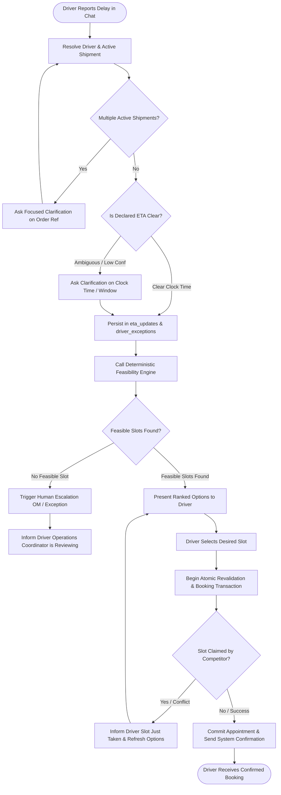

# SetuHaul Logistics — Problem Definition Sheet

**Project:** FDE Academy Mini Project 2  
**Problem Domain:** Autonomous Logistics Exception Resolution & Dock Scheduling  
**Target Organization:** SetuHaul Logistics Pvt. Ltd. (North & West India 3PL Operator)  
**Snapshot Baseline:** 4 August 2026, Asia/Kolkata (`+05:30`)

---

## 1. Business Problem Framing

In freight logistics, full-truckload (FTL) deliveries frequently experience transit disruptions caused by highway congestion, mechanical breakdowns, loading backlogs at origin, and adverse weather. When a truck is delayed, its planned dock appointment at the destination distribution centre becomes invalid. 

Currently, truck drivers communicate delays informally via chat or calls, often using colloquial, ambiguous phrasing (e.g., *"stuck in traffic, reaching around 11:20, any slot after 12?"*). Coordinating replacement dock capacity manually creates severe bottlenecks:
1. **Capacity Blind Spots:** Warehouse planners struggle to balance in-transit delays, trucks already waiting in the yard, dock breakdowns, and load-specific dock requirements (reefer vs heavy trailer vs standard dry van).
2. **Double-Booking Risks:** Multiple drivers arriving or calling at similar times compete for the same open slots. Under manual or naive automated allocation, race conditions result in double-booking or false confirmations.
3. **Conversational Friction:** Inexperienced chatbots either hallucinate available slots or repeatedly interrogate drivers for information already present in enterprise transport management systems (TMS).

---

## 2. In-Scope vs. Out-of-Scope Boundaries

### In-Scope (MVP Target)
- Inbound full-truckload exception resolution for SetuHaul distribution centres (`FAC-JAI-01` and `FAC-GGN-01`).
- Natural language driver chat interface for reporting delays, asking for available slots, selecting feasible options, and receiving authoritative booking status.
- Deterministic extraction and validation of driver declarations (ETA, delay duration, constraints).
- Authoritative operational context retrieval from the 18-table relational system of record.
- Hard compatibility checks: vehicle type, cargo weight, temperature requirements, facility hours (06:00–22:00 at Jaipur), and dock events (breakdowns/maintenance).
- Atomic, race-condition-proof appointment rescheduling enforcing database unique constraints.
- Transparent fallback and escalation to human operations coordinators for unresolvable cases (e.g., dock breakdowns with zero available capacity).

### Out-of-Scope (Explicit Non-Goals)
- Dynamic carrier rate negotiation, billing, freight penalties, or commercial settlements.
- Driver safety directives, driving-hour violations, or emergency mechanical assistance.
- Customs, hazardous materials (HAZMAT), or cross-border regulatory workflows.
- Real-time GPS telematics tracking (decisions rely on declared ETAs and physical gate check-ins).
- Full facility-wide multi-day mathematical schedule re-optimization (addressed in optional Phase 8).

---

## 3. Core Operational User Journeys

---

## 4. Measurable Success Metrics

The performance of the solution is evaluated across both conversational quality and deterministic system integrity:

| Metric | Target | Evaluation Mechanism |
|---|---|---|
| **Zero Double-Bookings** | 100% (0 violations) | Concurrent load tests with competing transactions targeting identical slots |
| **Integrity Constraint Violations** | 0 | Automated verification of partial unique indexes and foreign keys |
| **Deterministic Feasibility Accuracy** | 100% | Rejection of all weight/reefer/operating hour mismatches |
| **Driver Clarification Turns** | $\le 1$ turn for standard cases | Transcript evaluation on ambiguous identity or low-confidence ETA |
| **Ask-Only Read-Only Invariance** | 100% read-only | Zero appointment mutations during informational inquiries |
| **Safe Escalation Rate** | 100% of zero-capacity cases | Verification that `SHP1015` escalates to human queue without false confirmation |
| **End-to-End Resolution Latency** | $< 3.0$ seconds | Benchmark across multi-turn agent execution and SQLite queries |

---

## 5. Verified Data Snapshot Baseline

- **Distribution Facilities:** 2 (`FAC-JAI-01` Jaipur, `FAC-GGN-01` Gurugram).
- **Physical Dock Doors:** 9 docks (6 at Jaipur: D1–D4 Standard, D5 Reefer, D6 Heavy; 3 at Gurugram: D1–D2 Standard, D3 Reefer).
- **Active Operational Shipments:** 21 shipments (`SHP1001` through `SHP1021`).
- **Total Discrete Time Slots:** 106 slots across 08:00 to 22:00 on 4 August 2026.
- **Current Operational Incidents:**
  - `DEVT001`: Dock D3 leveller failure (10:00–13:00 blocked).
  - `DEVT002`: Dock D5 reefer maintenance (18:00–22:00 blocked).
  - `DEVT003`: Dock D2 unload overrun by `SHP1002`.
