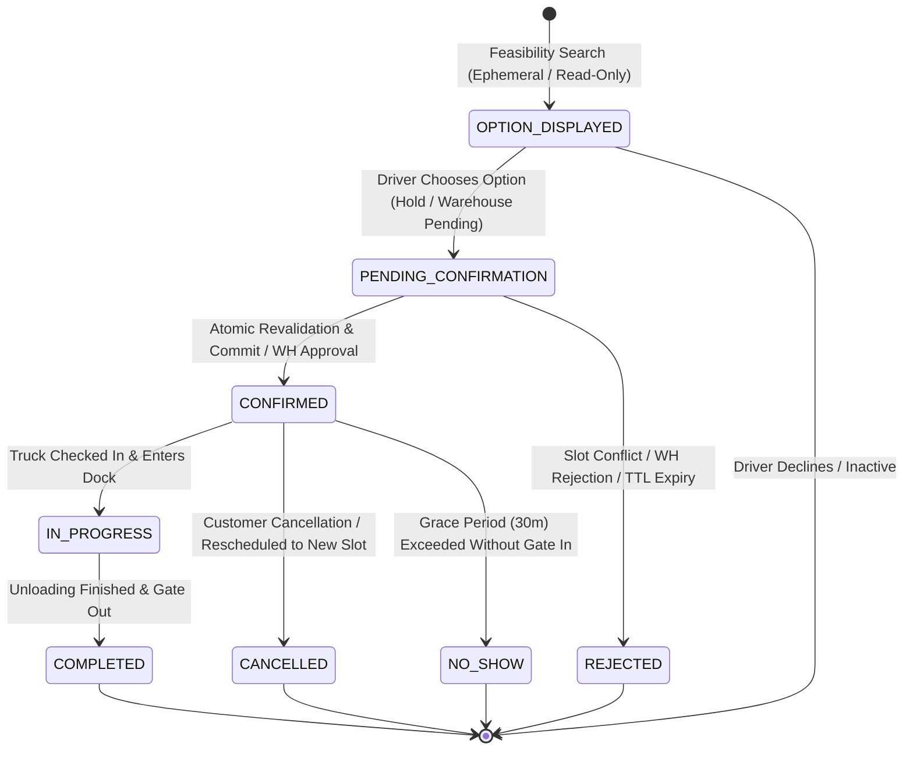
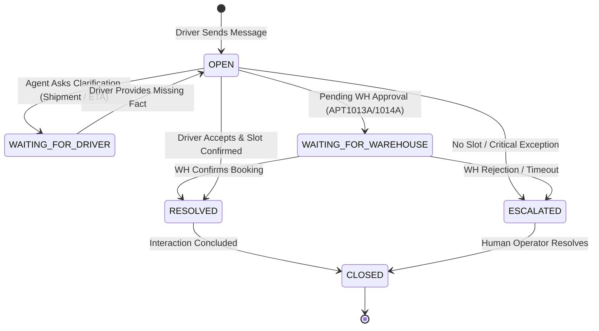

# SetuHaul Logistics — State Machines & Sequence Flows

**Document Status:** Engineering Specification  
**Scope:** State Transition Lifecycles, Concurrency Sequences, and Escalation Handshake  
**Target:** Antigravity Mini Project 2

---

## 1. Appointment State Machine

The appointment lifecycle maps directly to the verified database `CHECK` constraints on `appointments.appointment_status`:
```sql
CHECK (appointment_status IN ('PENDING_CONFIRMATION','CONFIRMED','IN_PROGRESS','COMPLETED','CANCELLED','NO_SHOW','REJECTED'))
```



### Transition Invariants
- `OPTION_DISPLAYED`: Stored in agent memory only; zero database mutations.
- `PENDING_CONFIRMATION`: Inserted into `appointments` with `is_current = 1`. Protected by `ux_active_appointment_per_slot`. Governed by a 15-minute TTL.
- `CONFIRMED`: Status updated with `confirmed_at = CURRENT_TIMESTAMP`. If replacing an earlier appointment, the previous appointment is updated with `is_current = 0, cancellation_reason = 'Rescheduled'`.
- `CANCELLED`: Releases slot immediately (`ux_active_appointment_per_slot` only indexes active statuses).

---

## 2. Chat Thread & Exception Lifecycles

### 2.1 Chat Thread Lifecycle (`chat_threads.thread_status`)


### 2.2 Driver Exception Lifecycle (`driver_exceptions.exception_status`)
- States: `OPEN` $\rightarrow$ `NEEDS_INFORMATION` $\rightarrow$ `SLOT_OPTIONS_SHARED` $\rightarrow$ `WAITING_CONFIRMATION` $\rightarrow$ `RESOLVED` / `ESCALATED` / `DUPLICATE` / `CANCELLED`.
- Idempotency guard: Retried webhook messages matching existing `dedupe_key` transition directly to `DUPLICATE` without triggering downstream actions.

---

## 3. Sequence Diagrams

### 3.1 Standard Journey: Delay Reporting, Feasibility, & Atomic Booking
```mermaid
sequenceDiagram
    autonumber
    actor Driver
    participant Chat as Driver Chat UI / API
    participant Agent as LangChain Agent
    participant Service as Feasibility & Booking Service
    participant DB as SQLite System of Record

    Driver->>Chat: "Traffic delay after Shahpura. Reaching ~11:20. Need slot after 12."
    Chat->>Agent: Process message with thread_id THR001
    Agent->>Service: resolve_driver_context(driver_id="DRV006")
    Service->>DB: Query shipments WHERE driver_id = 'DRV006' AND current_status != 'COMPLETED'
    DB-->>Service: Returns SHP1006 (Unique active shipment)
    Agent->>Service: record_eta_update(SHP1006, declared_eta="11:20", reason="TRAFFIC")
    Service->>DB: INSERT INTO eta_updates ...
    DB-->>Service: OK (ETA006)
    Agent->>Service: search_feasible_slots(shipment_id="SHP1006", min_time="11:20")
    Service->>DB: Check docks, operating rules, breakdowns, v_slot_availability
    DB-->>Service: Returns [SLOT-JAI-019 (12:00 D2), SLOT-JAI-047 (12:00 D4)]
    Service-->>Agent: FEASIBLE_SLOTS [Ranked by proximity to ETA]
    Agent-->>Chat: "I have updated your ETA to 11:20. At Jaipur DC, we have 2 standard slots available at 12:00 PM: Dock D2 and Dock D4. Would you like to book one?"
    Driver->>Chat: "Book Dock D4 at 12:00."
    Chat->>Agent: Confirm choice SLOT-JAI-047
    Agent->>Service: confirm_appointment(shipment_id="SHP1006", slot_id="SLOT-JAI-047")
    Service->>DB: BEGIN IMMEDIATE; Revalidate slot & UPDATE/INSERT appointment
    DB-->>Service: Commit Success (ux_active_appointment_per_slot satisfied)
    Service-->>Agent: BOOKING_CONFIRMED (Appointment APT1006B)
    Agent-->>Chat: "Confirmed! Your new appointment is booked at Dock D4 from 12:00 PM to 1:00 PM."
    Chat-->>Driver: Display Confirmation Card with Booking Ref
```

### 3.2 Race Condition: Competing Requests for Same Slot
```mermaid
sequenceDiagram
    autonumber
    actor DriverA as Driver A (SHP1006)
    actor DriverB as Driver B (SHP1012)
    participant Service as Feasibility & Booking Service
    participant DB as SQLite System of Record

    Note over DriverA, DriverB: Both drivers view available slot SLOT-JAI-047 (12:00 D4)
    DriverA->>Service: confirm_appointment(SHP1006, SLOT-JAI-047)
    DriverB->>Service: confirm_appointment(SHP1012, SLOT-JAI-047)
    
    Service->>DB: [Tx 1 for Driver A] BEGIN IMMEDIATE; INSERT appointments (SLOT-JAI-047)
    DB-->>Service: [Tx 1] Commit SUCCESS
    Service-->>DriverA: BOOKING_CONFIRMED (APT_A)
    
    Service->>DB: [Tx 2 for Driver B] BEGIN IMMEDIATE; INSERT appointments (SLOT-JAI-047)
    DB-->>Service: [Tx 2] sqlite3.IntegrityError: UNIQUE constraint failed: appointments.slot_id
    Note over Service, DB: Catch IntegrityError & ROLLBACK Tx 2
    Service->>DB: SELECT feasible alternative slots for SHP1012 after 11:10
    DB-->>Service: Returns [SLOT-JAI-019 (12:00 D2)]
    Service-->>DriverB: SLOT_CONFLICT: "Slot D4 12:00 was just reserved. Fresh feasible option available: Dock D2 at 12:00 PM."
```

### 3.3 Escalation Journey: No Feasible Slot Available (SHP1015)
```mermaid
sequenceDiagram
    autonumber
    actor Driver as Driver (SHP1015)
    participant Agent as LangChain Agent
    participant Service as Feasibility & Booking Service
    participant DB as SQLite System of Record
    actor Ops as Operations Coordinator

    Driver->>Agent: "ETA 18:30 with Reefer load. Can I unload tonight?"
    Agent->>Service: search_feasible_slots(shipment_id="SHP1015", min_time="18:30")
    Service->>DB: Query reefer docks & events for FAC-JAI-01
    Note over Service, DB: Dock D5 is only reefer bay; Event DEVT002 blocks 18:00-22:00.<br/>Facility closes at 22:00.
    DB-->>Service: 0 compatible slots available
    Service-->>Agent: NO_FEASIBLE_SLOT (Reefer dock maintenance DEVT002)
    Agent->>Service: create_human_escalation(shipment_id="SHP1015", reason="NO_FEASIBLE_SLOT")
    Service->>DB: INSERT INTO driver_exceptions (status='ESCALATED') & OM notification
    DB-->>Service: Escalation Ticket ESC005 Created
    Agent-->>Driver: "Jaipur DC's reefer bay D5 is closed for power maintenance from 6 PM to 10 PM. Because no other refrigerated bay is available tonight, I have escalated your case to Operations Coordinator Mahesh Verma. Please pull into the designated cold-chain holding bay."
    Service->>Ops: Alert queued on Operations Review Board (ESC005)
```
